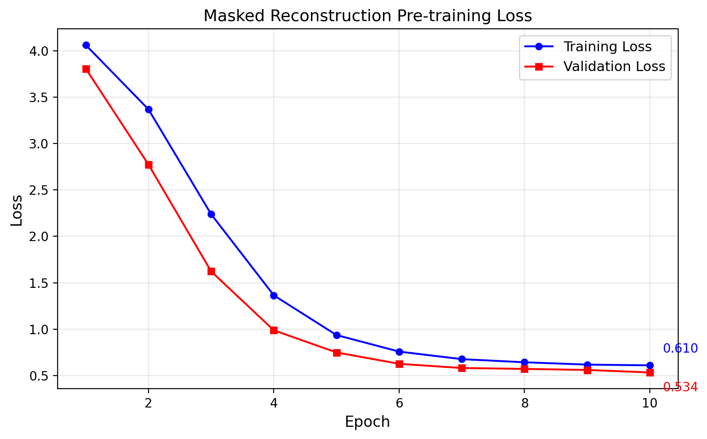
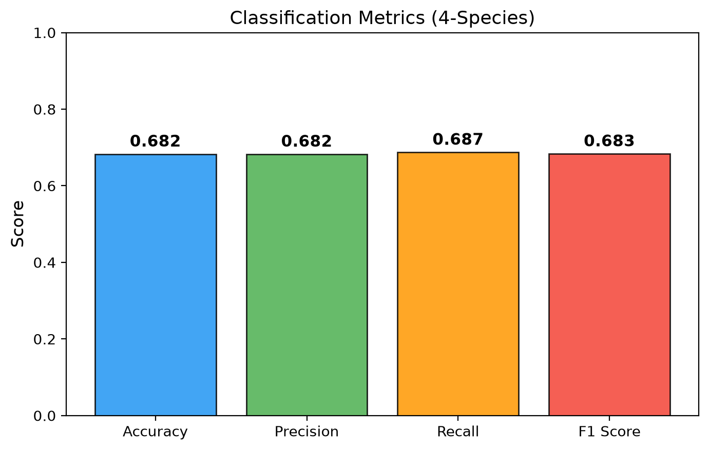
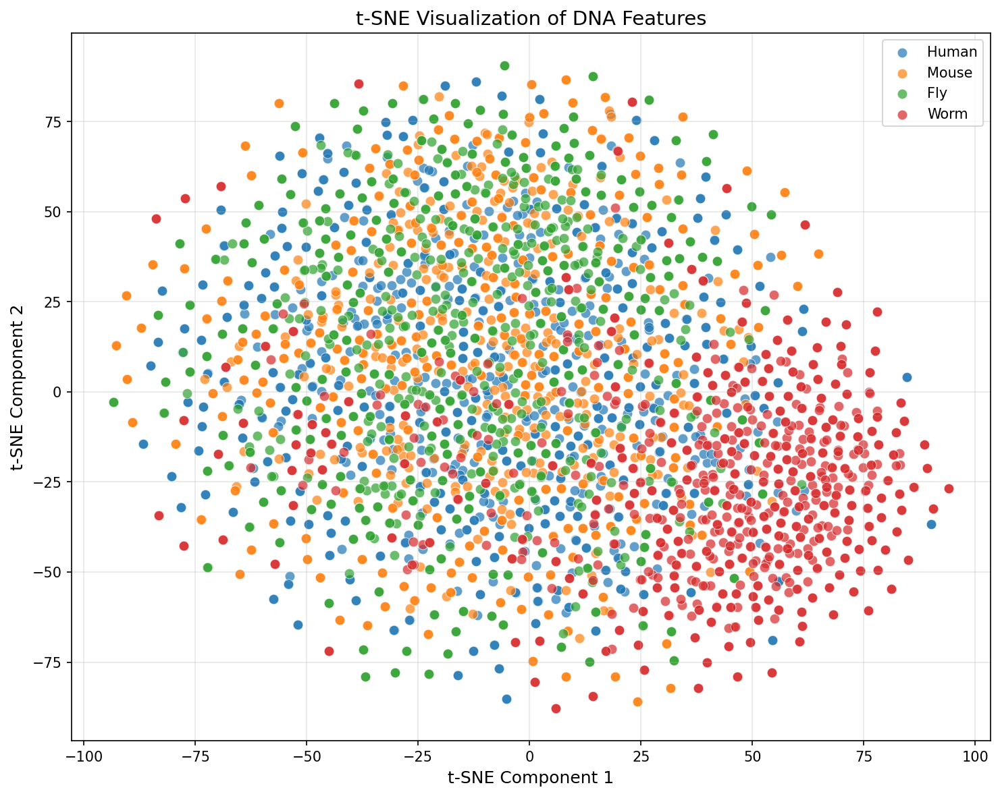
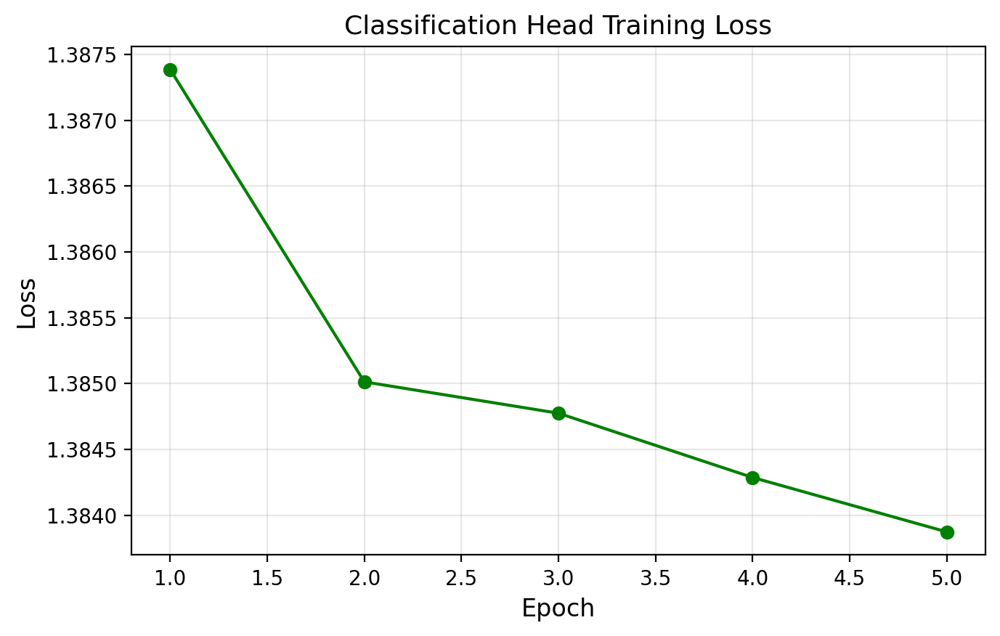

# Self-Supervised Learning for DNA Sequence Classification

Pretrain a convolutional neural network (CNN) encoder with masked reconstruction, freeze it, then train a multilayer perceptron (MLP) head to classify human, mouse, fly and worm sequences.

[中文](README.md)

This is a small representation-learning experiment with training logs, feature plots and debugging notes from an earlier chance-level classifier. Results come from a single run; repeated experiments across random seeds have not been performed.

## Results

| Stage | Metric | Value |
|---|---|---|
| Pretraining, 10 epochs | Training loss | 4.0609 → 0.6103 |
| | Validation loss | 3.8067 → 0.5339 |
| Classification, 50 epochs | **Validation accuracy** | **0.6825** |
| | Precision / recall / F1 | 0.6822 / 0.6871 / 0.6830 |
| | Four-class chance baseline | 0.2500 |

Validation accuracy rises from 0.319 at epoch 1 to 0.597 at epoch 25 and 0.683 at epoch 48. An earlier version reached only 0.2357. The fixes are described below.




## Method

**Pretraining:** split DNA into 3-mer tokens, giving a vocabulary of 64. Randomly mask 15% of positions and reconstruct them. A three-layer 1D CNN with BatchNorm and global average pooling produces 256-dimensional features.

**Downstream classification:** freeze the encoder, normalise its features, and train a two-layer MLP with ReLU. This is frozen-feature classification, not strict linear probing.

```text
DNA → 3-mer tokens → masking → CNN encoder → reconstruction
                                  |
                          freeze and extract features
                                  ↓
                         normalisation → MLP → four species
```

## Project Structure

```text
config/default.yaml               Data, model and training configuration
data/                             Genomic fragments for four species
docs/figures/                     Report figures
docs/report.md                    Experiment report
notebooks/visualization.ipynb      Interactive plots
results/                          Logs, checkpoint and visualisations
scripts/rerun_classification.py   Rerun classification from saved weights
src/
  kmer_encoding.py                Tokenisation
  data_preprocessing.py           Cleaning and sequence preparation
  dataset.py                      Masked and unmasked datasets
  cnn_encoder.py                  CNN encoder
  masked_reconstruction_model.py  Pretraining model
  pretrainer.py                   Pretraining loop
  classification_model.py         Frozen encoder and MLP head
  feature_visualization.py        PCA, t-SNE and clustering metrics
  experiment_runner.py            Full experiment
tests/                            Unit tests
requirements.txt                  Dependencies
```

## Quick Start

Use a Python environment compatible with the dependencies in `requirements.txt`.

```bash
pip install -r requirements.txt

# Full experiment: pretraining, classification and plots; slow on CPU
python src/experiment_runner.py

# Reuse the included pretrained checkpoint
python scripts/rerun_classification.py

# Unit tests
pytest tests/
```

## Output Files

The recorded run is under `results/experiment_20260624_151338/`:

| File | Contents |
|---|---|
| `experiment_results.json` | Metrics, loss and accuracy histories, configuration |
| `pretraining/final_model.pt` | Pretrained weights used by the rerun script |
| `visualizations/dna_features_pca.png` | Feature PCA projection |
| `visualizations/dna_features_tsne.png` | Feature t-SNE projection |

Pretraining logs are from the original June 24, 2026 run. Classification was rerun using the same pretrained weights after the fixes below. Generated Word reports and new experiment directories are ignored by Git.

## Known Limitations

- Feature separation remains weak: worm is more distinct, while human, mouse and fly overlap. The reported silhouette score over 3,051 feature vectors is 0.011.
- The experiment uses 3,051 sequences and only 10 pretraining epochs.
- Only the MLP on frozen features is trained downstream. Encoder fine-tuning and contrastive objectives were not evaluated.
- Fragments are fixed at 750 base pairs; variable-length behaviour is not evaluated.



## Post-mortem: Why the Classification Head Stayed Near Chance

### Symptoms

The original five-epoch classification loss moved from 1.3874 to 1.3839, close to `ln(4) = 1.3863`. The earlier recorded accuracy was 0.2357.

As a diagnostic, logistic regression on frozen encoder features reached 0.4389 validation accuracy, compared with 0.2500 when reproducing the original training loop. That suggested the features contained usable signal and that the head's training setup needed investigation.

### Findings and Fixes

| Finding | Fix |
|---|---|
| Calling the outer model's `train()` also changed the frozen encoder's BatchNorm and Dropout behaviour | Override `ClassificationModel.train()` to keep the encoder in `eval()` |
| Small feature magnitudes and a reused `1e-4` learning rate made head training ineffective | Add `BatchNorm1d` feature normalisation and use `1e-3` for the head |
| The loop was hard-coded to five epochs and did not monitor validation metrics | Make epochs and learning rate configurable, record validation metrics and restore the best weights |

Measured feature L2 norm medians were 0.455 in evaluation mode and 3.039 in training mode. Freezing parameters alone had not kept the feature distribution fixed.

Frozen features are now extracted and cached once instead of recomputing the CNN every epoch. Visualisation code also inspects the installed `TSNE` signature to select `n_iter` or `max_iter`.

| Run | Training loss | Validation accuracy |
|---|---|---|
| Before fixes | 1.3875 → 1.3880 | 0.2357 |
| After fixes | 1.1776 → 0.2563 | **0.6825** |



## Data

Fragments contain only A, C, G and T, each 750 base pairs long.

| Species | Sequences |
|---|---|
| human | 755 |
| mouse | 763 |
| fly | 753 |
| worm | 780 |

The 3,051 fragments are split 80/20 into 2,440 training and 611 validation examples.

## Licence

[MIT](LICENSE)
